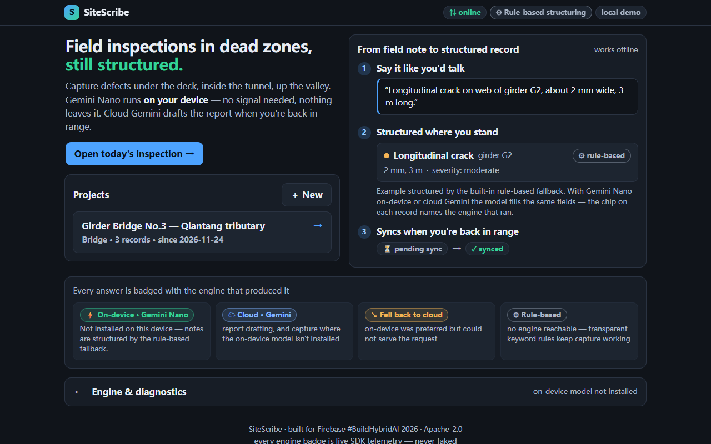
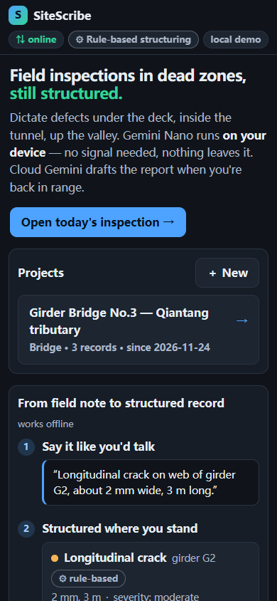
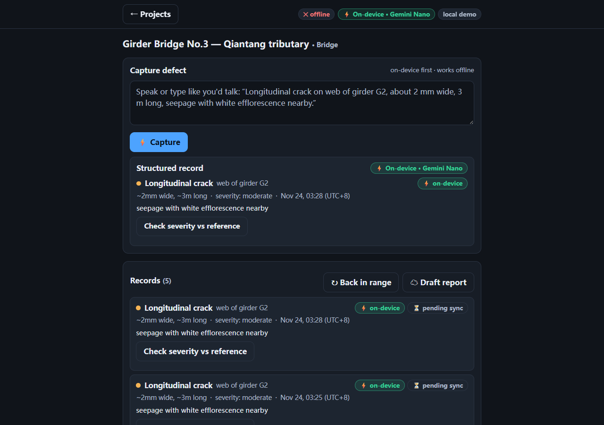

# SiteScribe

**Offline-first AI field inspection companion for civil engineers.**

Capture structured defect records inside signal-dead structures — bridge undersides, tunnels, mountain aqueducts — with **Gemini Nano running on-device** via [Firebase AI Logic](https://firebase.google.com/docs/ai-logic) hybrid inference, and switch to **cloud Gemini** for heavy report drafting when you're back in range.

[](LICENSE)
[](https://firebase.google.com/docs/ai-logic)
[](docs/SPEC.md)
[](#verified-state)

> Built for the Firebase **#BuildHybridAI 2026** hackathon (Web / Chrome platform).

## Screenshots

Taken from a local **demo-mode** build (no Firebase project wired up — the status bar says `local demo`).

| | |
|---|---|
|  |  |
| **Home.** Projects and the capture flow own the first screen; the four engine badges are a legend; telemetry sits in a collapsed *Engine & diagnostics* section. | **Capture (demo mode).** No AI engine is reachable in this build, so the record is structured by the labelled `⚙ rule-based` fallback — the badge says so. |
|  |  |
| **Engine & diagnostics** (opened): runtime, Prompt API, model availability, the demo-only simulation switches, and the engine log once there are events. | **Phone viewport (390 × 844).** |



**Real on-device inference, network cut.** Same local build with Chrome's built-in Gemini Nano installed: the note is structured **on the device** (`⚡ On-device · Gemini Nano`, read from the SDK's `inferenceSource`) and the record is `⏳ pending sync` because the device is offline.

## Why hybrid inference is the product here

1. Inspections happen where connectivity doesn't. An AI field assistant that dies offline is useless exactly where it's needed.
2. Infrastructure defect data is security-sensitive. It shouldn't leave the device by default.

Every AI output in SiteScribe carries a live **engine badge** — ⚡ `On-device · Gemini Nano` or ☁ `Cloud · Gemini` — driven by the SDK's own `GenerateContentResponse.inferenceSource`, never inferred or faked. When on-device was preferred but the SDK used the cloud, the badge says `↘ Fell back to cloud`. When no engine is reachable at all, a transparent keyword structurer keeps capture working and the badge says `⚙ Rule-based`.

## Feature routing

| Feature | Engine | Why |
|---|---|---|
| Note → structured defect record (JSON) | on-device first | happens offline; private |
| Field Q&A (single-turn) | on-device first | offline, general knowledge |
| Severity cross-check vs reference card | on-device | short context, private |
| Report drafting (aggregate) | cloud only | long-context aggregation |

See [docs/SPEC.md](docs/SPEC.md) for the full product specification.

## Run locally (demo mode — no Firebase project needed)

```bash
npm install
npm run dev
```

Open the printed URL in **Chrome 139+**, enable `chrome://flags/#prompt-api-for-gemini-nano-multimodal-input`, restart, then click **⚡ Capture** once — the on-device model downloads on first use (progress shows in the status chip). (`npm run dev` uses port 5173; if that is taken on your machine: `npm run dev -- --port 5187 --strictPort`.)

What you get in demo mode:

- Everything is stored locally; **the on-device path is real** if Chrome has the model, cloud calls fail honestly because no project is configured.
- The **status bar** always states which engine is on duty — `⚡ On-device ready`, `☁ Cloud engine · on-device optional`, or `⚙ Rule-based structuring` — and after each request shows the badge of the engine that answered.
- Offline demo: DevTools → Network → **Offline**, then capture a record; with the model installed the badge stays green ⚡ and the record is marked *pending sync*. **↻ Back in range** flips it to *synced* (in demo mode this is a simulation of the server acknowledgement).
- The home screen's **Engine & diagnostics** section (collapsed by default) shows live telemetry — runtime mode, Prompt API exposure, on-device model availability — and the engine log once there are events.
- If no engine is reachable at all (offline demo, no model), capture degrades to the clearly-labelled **⚙ rule-based** structurer — the loop never dies and nothing is faked.

For UI demonstrations of the cloud badge states before a Firebase project is wired up, append `?engine=sim_cloud` or `?engine=sim_fallback` — demo-mode-only, every badge carries "(simulated)", and a banner says so at the top of the page. Real runs never touch this path.

## Verified state

Last run on 2026-11-24 (Windows, Chrome 158, Node 24) against this exact tree:

| Command | What it proves | Result |
|---|---|---|
| `npm run check` | TypeScript, strict | 0 errors |
| `npm test` | rule-based extraction, conflict merge, pending queue, bootstrap env writer, local-time formatting, video timeline maths | 64 / 64 |
| `node scripts/e2e-full.mjs` | demo-mode loop on a fresh browser profile: seeds, local + zoned timestamps, a half-typed note survives a connectivity change, online capture synced, offline capture pending → synced, F1–F4 | 13 / 13 |
| `node scripts/e2e-emulator.mjs` | the **real Firebase SDK** chain (Auth, Firestore, Remote Config) against the local Emulator Suite: anonymous sign-in, offline write not on the server → arrives after reconnect, rules reject cross-user access (403), PWA shell renders after an offline reload | 19 / 19 |
| `node scripts/e2e-ondevice.mjs` | **real Gemini Nano on-device**, network cut (any fetch fails): the capture and Q&A badges come from `inferenceSource === "on_device"` | 2 / 2 |
| `node scripts/ui-screens.mjs` | WCAG contrast of every text/background pair, computed from real styles (all ≥ 4.5:1, minimum 5.7:1), plus a first-screen audit | exit 0 |
| clean checkout → `npm ci` → `check` / `test` / `build` → `npm run dev` | the quick-start needs nothing but this repository | install ok · 0 errors · 63 pass + 1 skipped (it reads the video script, which lives next to the repo) · build ok · app served |

Nothing on the on-device path can fake a pass: `e2e-ondevice.mjs` accepts only a genuine on-device badge and exits 2 (`tools/ondevice-proof.json` → `model-not-available`) when the model is absent.

```bash
npm test                                   # unit tests
node scripts/e2e-full.mjs                  # needs `npm run dev` (or --port <n>)
node scripts/e2e-emulator.mjs              # builds, boots and stops the Emulator Suite itself
node scripts/e2e-ondevice.mjs              # on-device proof — real on-device badge only, honest skip otherwise
node scripts/ui-screens.mjs                # screenshots + contrast/first-screen audit → ../tools/
```

### Launching Chrome for on-device runs

Puppeteer's **default launch args include `--disable-features=…OptimizationHints…`**, which alone makes `LanguageModel.availability()` report `unavailable` forever (A/B verified 2026-11-23 — the culprit was never the machine's GPU). Any harness that exercises the on-device path must keep that feature on. Note that `ignoreDefaultArgs: ["--disable-features"]` does **not** work (the list is one full string and puppeteer filters by exact match); use `args: ["--enable-features=OptimizationHints"]` with `puppeteer.launch`, or start chrome.exe yourself and `puppeteer.connect({ browserURL })`. Both `scripts/e2e-ondevice.mjs` and `scripts/capture-video.mjs` use the first form and take `--profile`, which must point at a Chrome profile that already has the Gemini Nano component installed — the model is a per-profile ~4 GB download (about 35 minutes on a slow line; Chrome fetches it once `LanguageModel.create()` is called). `scripts/e2e-ondevice.mjs` fails honestly (exit 2, `tools/ondevice-proof.json` says `model-not-available`) when the model isn't in place; nothing is ever simulated on that path.

Two behaviours worth knowing when running on-device: the SDK's on-device path ignores `generationConfig` (so the structuring prompt spells out the JSON keys itself), and the first inference of a browser session also loads the weights — the app preloads an already-installed model at boot and gives that first call a longer budget.

## Emulator suite (proves the real-SDK path, no Firebase project needed)

`firebase.json` configures the Emulator Suite (auth 9099, firestore 8080, hosting 5000, UI 4000) and `.firebaserc` pins the reserved demo project id `demo-sitescribe`.

```bash
# once: extract a JDK (e.g. Temurin 21) and point JAVA_HOME at it
VITE_USE_EMULATOR=1 npm run build          # bakes the emulator flag into dist/
firebase emulators:start                   # then open http://127.0.0.1:5000
```

`node scripts/e2e-emulator.mjs` does all of the above itself (build, boot, headless Chrome, teardown) and asserts: anonymous sign-in really creates a user; a record captured **offline** lands in the Firestore emulator after reconnect (verified by a direct REST read); Remote Config falls back to baked-in defaults; and the security rules reject cross-user reads (403 via REST with both users' idTokens). Screenshots land in `../tools/emu-*.png`.

## Demo video pipeline

The film is cut from a real screen recording, timed by its own narration. `submission/VIDEO-SCRIPT-EN.md` (next to the repo) is the single source of truth: its narration lines become the voice-over files (`scripts/make-vo.mjs`) **and** the subtitle text, and its shot ↔ narration map tells the assembler which shot carries which line.

```bash
# 1. record the app (hosted URL for the real film) — frames + timestamps + marks + on-screen badges
node scripts/capture-video.mjs --url https://<project>.web.app --out ../tools/video --dpr 1.5
# 2. cut: every shot is padded/trimmed to its narration, subtitles burned, 1080p30 H.264 + AAC
node scripts/assemble-video.mjs --session ../tools/video --github-url https://github.com/<you>/sitescribe --still cold-open=<photo>
```

`--dpr 1.5` records 1920×1200 frames, which keeps the UI readable **and** crisp after the 1080p downscale (the default `--dpr 1` gives 1280×800 frames that are upscaled). `assemble-video.mjs` resamples the variable-rate screencast to a constant 30 fps **by timestamp**, anchors the on-screen action to the narration through the harness's marks (typing fills the dictated line, the result lands as its explanation starts, thinking time is cut), mixes the voice-over sample-accurately, and then **verifies the render numerically** — duration, frame count, codecs, and for every narration line its position (lag), its identity (correlation with the source clip) and the silence around it. It exits non-zero if anything is off.

Honesty guards: every render is stamped `TEST RENDER — not the final video`. `--final` is refused unless every capture was recorded from a hosted https URL, no shot is missing, the cold open is a real photo and no simulated badge was on camera. A missing shot is an error, never black frames.

## Ship it: one-command bootstrap (needs your Google login once)

```bash
node scripts/firebase-bootstrap.mjs --login
```

Creates the Firebase project, web app, Firestore database, writes `.env` (git-ignored), deploys hosting + Firestore rules + Remote Config, and *verifies* what it can (anonymous sign-in probe via `accounts:signUp`, hosting URL fetch). `--dry-run` prints every step without touching anything; `--deploy-only` rebuilds and redeploys after you paste an App Check key. Remaining console clicks (Anonymous auth, AI Logic "Get started", App Check key) are printed with exact navigation paths.

> App Check is required by Firebase AI Logic (auto-enforced since 2026-11-02). The app resolves it at build time: debug provider on localhost, `VITE_RECAPTCHA_SITE_KEY` (recommended for the hosted URL) or `VITE_APPCHECK_DEBUG_TOKEN` (accepted by the hackathon rules) from `.env` — see `.env.example`.

## Run with Firebase

1. Create a Firebase project; add a Web app; copy the config.
2. `cp .env.example .env` and paste the config as one line.
3. Enable **Authentication → Anonymous**, **Firestore**, and the **AI Logic** workflow (Gemini Developer API provider).
4. Register the App Check **debug token** printed in your console at *App Check → Apps → Manage debug tokens* (or set a reCAPTCHA site key — see above).
5. `npm run dev` (or `firebase deploy` after `npm run build`).

## Stack

Vite · TypeScript (no UI framework) · Firebase AI Logic / Auth / Firestore / Remote Config / App Check · Apache-2.0
