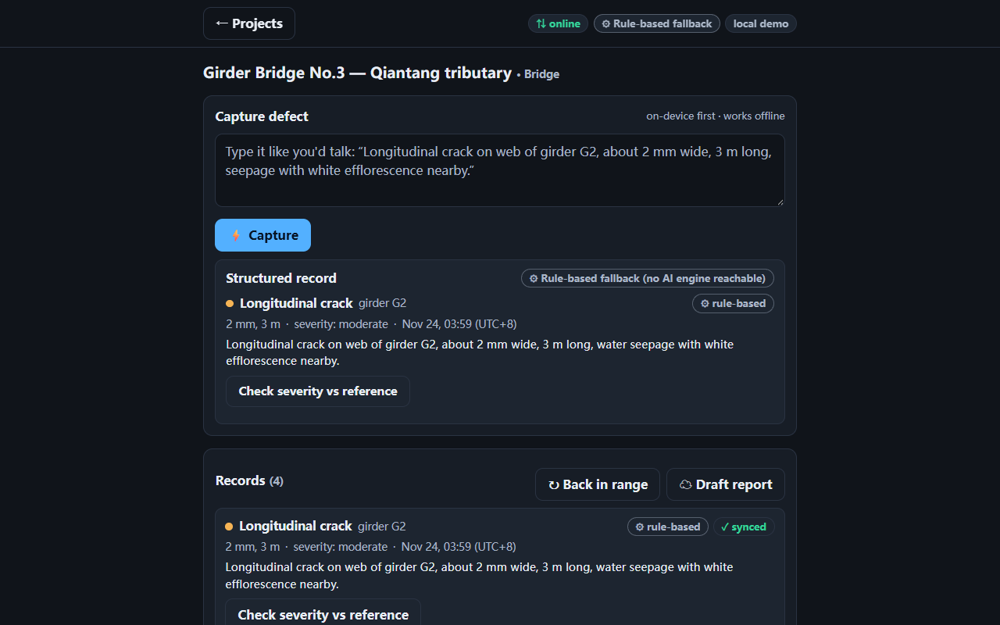
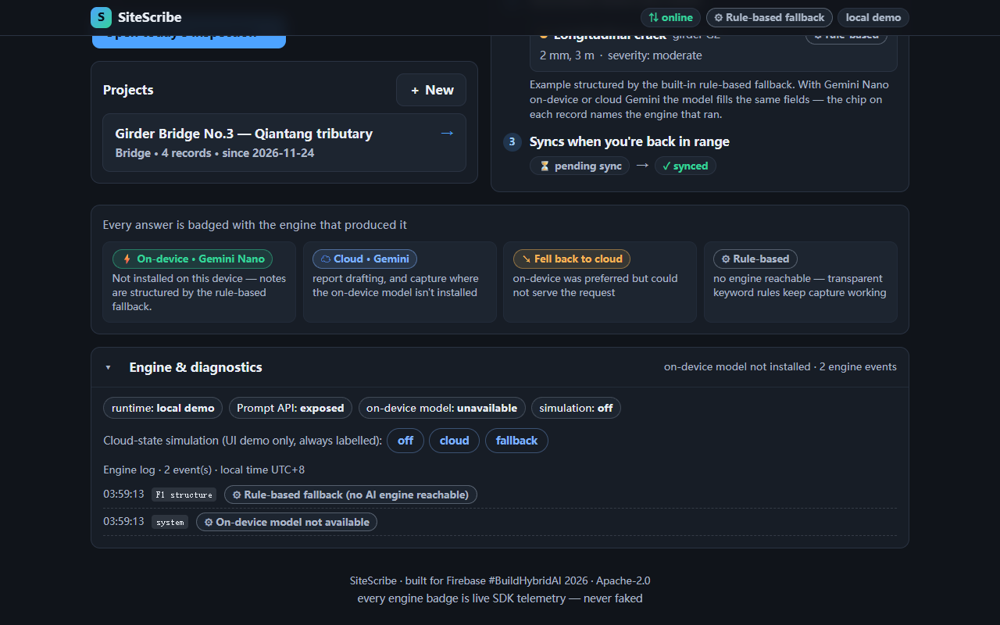

# SiteScribe

**Offline-first AI field inspection companion for civil engineers.**

Capture structured defect records inside signal-dead structures — bridge undersides, tunnels, mountain aqueducts — with **Gemini Nano running on-device** via [Firebase AI Logic](https://firebase.google.com/docs/ai-logic) hybrid inference, and switch to **cloud Gemini** for heavy report drafting when you're back in range.

[](LICENSE)
[](https://firebase.google.com/docs/ai-logic)
[](docs/SPEC.md)
[](#verified-state)

> Built for the Firebase **#BuildHybridAI 2026** hackathon (Web / Chrome platform).

## Screenshots

Taken from a local **demo-mode** build — the status bar says `local demo`; that mode needs no Firebase project.

| | |
|---|---|
|  |  |
| **Home.** Projects and the capture flow own the first screen; the four engine badges are a legend; telemetry sits in a collapsed *Engine & diagnostics* section. | **Capture (demo mode).** No AI engine is reachable in this build, so the record is structured by the labelled `⚙ rule-based` fallback — the badge says so. |
|  |  |
| **Engine & diagnostics** (opened): runtime, Prompt API, model availability, the demo-only simulation switches, and the engine log once there are events. | **Phone viewport (390 × 844).** |


**Real on-device inference, network cut.** Same local build with Chrome's built-in Gemini Nano installed: the note is structured **on the device** (`⚡ On-device · Gemini Nano`, read from the SDK's `inferenceSource`) and the record is `⏳ pending sync` because the device is offline.

## Why hybrid inference is the product here

1. Inspections happen where connectivity doesn't. An AI field assistant that dies offline is useless exactly where it's needed.
2. Infrastructure defect data is security-sensitive. It shouldn't leave the device by default.

Every AI output in SiteScribe carries a live **engine badge** — ⚡ `On-device · Gemini Nano` or ☁ `Cloud · Gemini` — driven by the SDK's own `GenerateContentResponse.inferenceSource`, never inferred or faked. When on-device was preferred but the SDK used the cloud, the badge says `↘ Fell back to cloud`. When no engine is reachable at all, a transparent keyword structurer keeps capture working and the badge says `⚙ Rule-based`. The same holds when a model did answer but with text that could not be used: the fields come from the rules, and the record — its badge, its chip and the engine stored with it — says rule-based.

## Feature routing

| Feature | Engine | Why |
|---|---|---|
| Note → structured defect record (JSON) | on-device first | happens offline; private |
| Field Q&A (single-turn) | on-device first | offline, general knowledge |
| Severity cross-check vs reference card | on-device | short context, private |
| Report drafting (aggregate) | cloud only | long-context aggregation |

See [docs/SPEC.md](docs/SPEC.md) for the full product specification.

## Run locally (demo mode — no Firebase project needed)

```bash
npm install
npm run dev
```

Open the printed URL in **Chrome 139+**, enable `chrome://flags/#prompt-api-for-gemini-nano-multimodal-input`, restart, then click **⚡ Capture** once — the on-device model downloads on first use (progress shows in the status chip). (`npm run dev` uses port 5173; if that is taken on your machine: `npm run dev -- --port 5187 --strictPort`. A `.env` with a Firebase config switches the dev server to live mode; for demo mode blank it: `VITE_FIREBASE_CONFIG= npm run dev`.)

What you get in demo mode:

- Everything is stored locally; **the on-device path is real** if Chrome has the model, cloud calls fail honestly because no project is configured.
- **The first click never waits for the model.** On a browser without Gemini Nano, the first **⚡ Capture** starts Chrome's background download and the note is structured right away — in demo mode by the labelled rule-based fallback. With a Firebase project the cloud engine answers instead wherever the project can use the Gemini API; on the project behind the hosted URL that has not been observed yet (see [Verified state](#verified-state)). Download progress shows in the status chip **only until the first answer exists**; after that the chip shows the badge of the latest answer, and the progress is in the home-screen legend note and the *Engine & diagnostics* summary. Each answer's badge says which one ran; later captures switch to on-device once the model is ready.
- The **status bar** always states which engine is on duty — `⚡ On-device ready`, `☁ Cloud engine · on-device optional`, or `⚙ Rule-based structuring` — and after each request shows the badge of the engine that answered. It keeps that badge: the model warm-up's own status line ("On-device model unavailable", …) goes to the engine log, not over an answer.
- **A hung connection does not hang the app.** Every call runs under a time budget (12 s in demo mode on a browser without the model). If the network neither answers nor fails, capture and the severity check fall back to the labelled rules, a question gets "No engine answered in time", and report drafting "Report drafting timed out". A reply that arrives after the budget is dropped.
- *Check severity vs reference* does the same on the capture preview and on every record in the list.
- Offline demo: DevTools → Network → **Offline**, then capture a record; with the model installed the badge stays green ⚡ and the record is marked *pending sync*. **↻ Back in range** flips it to *synced* (in demo mode this is a simulation of the server acknowledgement).
- The home screen's **Engine & diagnostics** section (collapsed by default) shows live telemetry — runtime mode, Prompt API exposure, on-device model availability — and the engine log once there are events.
- If no engine is reachable at all (offline demo, no model), capture degrades to the clearly-labelled **⚙ rule-based** structurer — the loop never dies and nothing is faked.

For UI demonstrations of the cloud badge states before a Firebase project is wired up, append `?engine=sim_cloud` or `?engine=sim_fallback` — demo-mode-only. Every answer badge, legend chip and record card carries "(simulated)", the status chip shows the simulated label before and after each answer, and a banner says so at the top of both views. The simulated report is a short report-shaped text that says no report was drafted. A record made under the simulation keeps its label after the simulation is switched off. Real runs never show it.

Two Remote Config keys are kill-switches: `feature_report_drafting` and `feature_severity_check`, both on by default. When one is `false` the feature is not offered — its control is disabled, one line under *Records* says why, and no request is sent. Demo mode has no Remote Config, so the same state can be tried with `?feature_report_drafting=false` and/or `?feature_severity_check=false` (demo mode only).

With a Firebase project the app renders before the anonymous sign-in or Remote Config answers, so the page opens even where Google is unreachable; the Projects panel says “Signing in anonymously…” until the sign-in gets through. If the deployment has not enabled anonymous sign-in, the panel says that instead — with the console path that changes it, and that reloading will not help; any other failure of the sign-in keeps the advice to check the connection. Fetched Remote Config values are applied whenever they arrive.

When the project cannot use the Gemini API (below), every answer names the cause in its badge — for example `⚙ Rule-based fallback (the cloud engine is not available on this project)` — instead of the `no AI engine reachable` wording that would send the reader after a connection that is fine. The record is rule-based, as for any failed call.

## Verified state

Last run on 2026-11-26 (Windows, Chrome 158, Node 24) against this exact tree for `check`, `test`, `e2e-full` and `live-readiness`; every other row carries the date of its own last run.

| Command | What it proves | Result |
|---|---|---|
| `npm run check` | TypeScript, strict | 0 errors |
| `npm test` | rule-based extraction, engine attribution, call budgets and late replies, what a cloud refusal and a refused sign-in mean, simulation texts, Remote Config feature switches, conflict merge, pending queue, bootstrap env writer, the readiness checks' decisions, local-time formatting, video timeline maths | 135 / 135 |
| `node scripts/e2e-full.mjs` | demo-mode loop on a fresh browser profile: seeds, local + zoned timestamps, a half-typed note survives a connectivity change, online capture synced, offline capture pending → synced, F1–F4; the two capture edge cases (a reply that cannot be used, a reply with no engine named) with canned SDK replies; simulation labelling; the feature switches; a hung network, where every call falls back within its budget and a late reply changes nothing; a cloud engine the project cannot use — the AI Logic request is answered with the real project's HTTP 403 and every badge, the status chip and every log row name the cause, the capture stays rule-based and the report is no report | 41 / 41 |
| `node scripts/e2e-emulator.mjs` | the **real Firebase SDK** chain (Auth, Firestore, Remote Config) against the local Emulator Suite: anonymous sign-in, offline write not on the server → arrives after reconnect, rules reject cross-user access (403), PWA shell renders after an offline reload, the demo-only URL switches have no effect there, the AI Logic request names the configured cloud model, and the first render does not wait for the network — with every Firebase / Google request held, the page still rendered at once (84 ms in that run) | 27 / 27 † (2026-11-25) |
| `node scripts/e2e-ondevice.mjs` | **real Gemini Nano on-device**, network cut (any fetch fails): the capture and Q&A badges come from `inferenceSource === "on_device"` | 2 / 2 — four runs on 2026-11-25, the last three on the final capture path, the last with a clean tree |
| `node scripts/ui-screens.mjs` | WCAG contrast of every text/background pair, computed from real styles (all ≥ 4.5:1, minimum 5.7:1), plus a first-screen audit | exit 0 (2026-11-25) |
| `node scripts/live-readiness.mjs` | the **real project**, no browser: the CLI is logged in; the hosting URL answers and serves the build in `dist/`; anonymous sign-in; Gemini through AI Logic with the registered App Check debug token | **3 / 5** — hosting serves the deployed build ✓ · anonymous sign-in **not enabled** (`CONFIGURATION_NOT_FOUND`) ✗ · Gemini **refused** (`FREE_TIER_UNAVAILABLE`, HTTP 403) ✗ |
| a local **live-mode** build against the real project, headless Chrome | what a visitor sees while the two owner steps are pending: the Projects panel says “This deployment has not enabled anonymous sign-in (CONFIGURATION_NOT_FOUND) … Reloading the page does not help until then.”, ＋ New is refused with the same reason; the Remote Config fetch itself succeeds (`no-change` after 1.9 s) | observed 2026-11-26 |
| clean copy (`git archive`) → `npm ci` → `check` / `test` / `build` → served by the hosting emulator | the quick-start needs nothing but this repository | install ok · 0 errors · 104 pass + 1 skipped (it reads the video script, which lives next to the repo) · build ok · app served (2026-11-25) |

† 2026-11-25: port 8080 was held by an unrelated service on that machine, so the suite ran on a clean copy whose only difference was the Firestore emulator port (8090 instead of 8080). The last run with the standard configuration was on 2026-11-24: 19 / 19.

**Never observed for real: a cloud answer.** `☁ Cloud · Gemini` and `↘ Fell back to cloud · Gemini` have only ever been seen as the labelled demo simulation. On 2026-11-26 the project behind the hosted URL answered every AI Logic call with HTTP 403 “The Gemini API free tier is not available for this project” — the builder's Google account cannot use the free tier until a device is verified or billing is linked. For the same reason **App Check is not proven end to end**: the registered debug token exchanges for an App Check token, but the request is refused the same way with a garbage token and with none at all, so nothing shows yet that AI Logic accepts the attestation. Only a Gemini answer through AI Logic would.

Nothing on the on-device path can fake a pass: `e2e-ondevice.mjs` accepts only a genuine on-device badge and exits 2 (`tools/ondevice-proof.json` → `model-not-available`) when the model is absent.

```bash
npm test                                   # unit tests
node scripts/e2e-full.mjs                  # needs `npm run dev` (or --port <n>)
node scripts/e2e-emulator.mjs              # builds, boots and stops the Emulator Suite itself
node scripts/e2e-ondevice.mjs              # on-device proof — real on-device badge only, honest skip otherwise
node scripts/ui-screens.mjs                # screenshots + contrast/first-screen audit → ../tools/
node scripts/live-readiness.mjs            # the real project: is the hosted app ready? (needs .env, npm run build)
```

### Launching Chrome for on-device runs

Puppeteer's **default launch args include `--disable-features=…OptimizationHints…`**, which alone makes `LanguageModel.availability()` report `unavailable` forever (A/B verified 2026-11-23 — the culprit was never the machine's GPU). Any harness that exercises the on-device path must keep that feature on. Note that `ignoreDefaultArgs: ["--disable-features"]` does **not** work (the list is one full string and puppeteer filters by exact match); use `args: ["--enable-features=OptimizationHints"]` with `puppeteer.launch`, or start chrome.exe yourself and `puppeteer.connect({ browserURL })`. Both `scripts/e2e-ondevice.mjs` and `scripts/capture-video.mjs` use the first form and take `--profile`, which must point at a Chrome profile that already has the Gemini Nano component installed — the model is a per-profile ~4 GB download (about 35 minutes on a slow line; Chrome fetches it once `LanguageModel.create()` is called). `scripts/e2e-ondevice.mjs` fails honestly (exit 2, `tools/ondevice-proof.json` says `model-not-available`) when the model isn't in place; nothing is ever simulated on that path.

Two behaviours worth knowing when running on-device: the SDK's on-device path ignores `generationConfig` (so the structuring prompt spells out the JSON keys itself), and the first inference of a browser session also loads the weights — the app preloads an already-installed model at boot and gives that first call a longer budget.

## Emulator suite (proves the real-SDK path, no Firebase project needed)

`firebase.json` configures the Emulator Suite (auth 9099, firestore 8080, hosting 5000, UI 4000) and `.firebaserc` pins the reserved demo project id `demo-sitescribe`.

```bash
# once: extract a JDK (e.g. Temurin 21) and point JAVA_HOME at it
VITE_USE_EMULATOR=1 npm run build          # bakes the emulator flag into dist/
firebase emulators:start                   # then open http://127.0.0.1:5000
```

`node scripts/e2e-emulator.mjs` does all of the above itself (build, boot, headless Chrome, teardown) and asserts: anonymous sign-in really creates a user; a record captured **offline** lands in the Firestore emulator after reconnect (verified by a direct REST read); Remote Config falls back to baked-in defaults; and the security rules reject cross-user reads (403 via REST with both users' idTokens). Screenshots land in `../tools/emu-*.png`.

## Demo video pipeline

The film is cut from a real screen recording, timed by its own narration. `submission/VIDEO-SCRIPT-EN.md` (next to the repo) is the single source of truth: its narration lines become the voice-over files (`scripts/make-vo.mjs`) **and** the subtitle text, and its shot ↔ narration map tells the assembler which shot carries which line.

```bash
# 1. record the app (hosted URL for the real film) — frames + timestamps + marks + on-screen badges
node scripts/capture-video.mjs --url https://<project>.web.app --out ../tools/video --dpr 1.5
# 2. cut: every shot is padded/trimmed to its narration, subtitles burned, 1080p30 H.264 + AAC
node scripts/assemble-video.mjs --session ../tools/video --github-url https://github.com/<you>/sitescribe --still cold-open=<photo>
```

`--dpr 1.5` records 1920×1200 frames, which keeps the UI readable **and** crisp after the 1080p downscale (the default `--dpr 1` gives 1280×800 frames that are upscaled). `assemble-video.mjs` resamples the variable-rate screencast to a constant 30 fps **by timestamp**, anchors the on-screen action to the narration through the harness's marks (typing fills the dictated line, the result lands as its explanation starts, thinking time is cut), mixes the voice-over sample-accurately, and then **verifies the render numerically** — duration, frame count, codecs, and for every narration line its position (lag), its identity (correlation with the source clip) and the silence around it. It exits non-zero if anything is off.

Honesty guards: every render is stamped `TEST RENDER — not the final video`. `--final` is refused unless every capture was recorded from a hosted https URL, no shot is missing, the cold open is a real photo and no simulated badge was on camera. A missing shot is an error, never black frames.

## Ship it: one-command bootstrap (needs your Google login once)

```bash
node scripts/firebase-bootstrap.mjs --login                               # a new project, end to end
node scripts/firebase-bootstrap.mjs --existing-project --project-id <id>   # a project made in the Firebase console
node scripts/firebase-bootstrap.mjs --deploy-only                          # rebuild + redeploy after any change
```

Creates (or adopts) the Firebase project and its web app, creates the Firestore database, writes `.env` (git-ignored), deploys hosting + Firestore rules + Remote Config, and verifies what it can (anonymous sign-in probe via `accounts:signUp`, hosting URL fetch). `--dry-run` prints every step without touching anything.

What the project behind the hosted URL needed beyond that (2026-11-26), and who can do it:

| Piece | How | Who |
|---|---|---|
| Hosting, Firestore rules and indexes, Remote Config | `firebase deploy` — the bootstrap's step 5 | the CLI |
| **AI Logic with the Gemini Developer API provider** | `FIREBASE_CLI_EXPERIMENTS=ailogic firebase ailogic:providers:enable gemini-developer-api --project <projectId>`; the console's *AI Logic → Get started* sets the provider up as well. Until the project's AI Logic configuration exists, every call answers “Firebase AI Logic genai config not found” | the CLI or the console |
| **App Check** | either a debug token registered for the web app — `firebase appcheck:debugtokens:create <uuid> --app <appId> --display-name <name> --no-save-local`, its value in `.env` as `VITE_APPCHECK_DEBUG_TOKEN` — or a reCAPTCHA site key registered under *App Check → Apps → web app → Register*, as `VITE_RECAPTCHA_SITE_KEY` (real attestation; the better choice for a public URL) | the CLI or the console |
| **Gemini API free tier** | it may be **unavailable for your Google account**: every call then answers HTTP 403 “The Gemini API free tier is not available for this project”. Verify a device at `https://aistudio.google.com/verify?project=<projectId>` (free), or link billing at `https://aistudio.google.com/billing` | **the account owner only** |
| **Authentication → Anonymous** | *Firebase console → the project → Authentication → Sign-in method → Anonymous → Enable → Save*. Console only: until the owner has opened Authentication there, the project has no Identity Toolkit configuration, and every API or CLI route to enable it answers `CONFIGURATION_NOT_FOUND` | **the account owner only** |

> App Check is required by Firebase AI Logic (enforced since 2026-11-02). The app resolves its provider at build time: the debug provider on localhost, `VITE_RECAPTCHA_SITE_KEY` (v3, or Enterprise with `VITE_RECAPTCHA_PROVIDER=enterprise`) or `VITE_APPCHECK_DEBUG_TOKEN` from `.env` — see `.env.example`.
>
> **A debug token in `.env` is a debug token in the public bundle.** Anyone can read it there and exchange it for App Check tokens of this app, so it attests nothing about who is calling. The hackathon's rules accept debug tokens; Firebase's own documentation advises against shipping them in a production build. The hosted URL uses one. To move it to real attestation: register a reCAPTCHA site key, set `VITE_RECAPTCHA_SITE_KEY`, redeploy, then delete the debug token (`firebase appcheck:debugtokens:delete`).

## Before you record / before you submit

```bash
npm run build                            # so that (b) compares the hosted page with the current build
node scripts/live-readiness.mjs          # [--model <name>], default gemini-3.8-flash
```

One command, no browser. It reads `.env`, changes nothing in the project, and prints no key and no token:

- **(a)** whether the Firebase CLI is logged in, and the project the app is wired to;
- **(b)** whether the hosting URL answers, and whether the page it serves is the build in `dist/` — the hashed asset names of the served `index.html` against the local one;
- **(c)** whether anonymous sign-in is enabled (`POST accounts:signUp` with an empty body; when it is not, it says which of `CONFIGURATION_NOT_FOUND` / `ADMIN_ONLY_OPERATION` / `OPERATION_NOT_ALLOWED` came back). The probe signs up one anonymous user when it succeeds, as the bootstrap does;
- **(d)** whether Gemini answers through AI Logic — the real SDK, the App Check debug token exchanged the way the SDK's debug provider does, then one `generateContent`. A refusal is classified as `FREE_TIER_UNAVAILABLE`, `GENAI_CONFIG_NOT_FOUND`, `APP_CHECK`, `NETWORK` or `OTHER`, with the server's words.

Then a two-line verdict names the step that is still missing. Exit 0 only when every check is green, 1 when something is red, 2 without a `.env`. Run it after every console click and every deploy.

Two things the script does **not** prove:

- **(d) needs a `VITE_APPCHECK_DEBUG_TOKEN` in `.env`:** the script can exchange a debug token but cannot produce reCAPTCHA attestation. If the deployed bundle uses `VITE_RECAPTCHA_SITE_KEY`, it says so and (d) is reported as not probed — check the hosted URL in a browser instead.
- **An exchanged App Check token is not proof that AI Logic accepts the attestation.** While the Gemini side refuses the call, it refuses it with a valid token, a garbage one and none at all alike. Only a Gemini answer through AI Logic — a green (d) — shows App Check end to end.

Two steps only the account owner can take; no API or CLI command does either:

| Step | Where | Done when |
|---|---|---|
| Enable anonymous sign-in | Firebase console → the project → **Authentication → Sign-in method → Anonymous → Enable → Save** | (c) reads `ENABLED ✓` |
| Gemini API free tier — it may be unavailable for your Google account | verify a device at `https://aistudio.google.com/verify?project=<projectId>` (free), or link billing at `https://aistudio.google.com/billing` | (d) reads `OK ✓` |

## Run with Firebase

1. Wire the project as above. `.env` holds the web app's config as `VITE_FIREBASE_CONFIG`.
2. `npm run build` bakes that config into `dist/`; `firebase deploy` (or the bootstrap) serves it at `https://<projectId>.web.app`.
3. `npm run dev` on `localhost` runs **live mode** against the same project. *(The demo-mode e2e suite needs the config blanked once a `.env` exists: `VITE_FIREBASE_CONFIG= npm run dev -- --port 5187 --strictPort`.)*
4. Before you record or submit: `node scripts/live-readiness.mjs`.

## Stack

Vite · TypeScript (no UI framework) · Firebase AI Logic / Auth / Firestore / Remote Config / App Check · Apache-2.0
